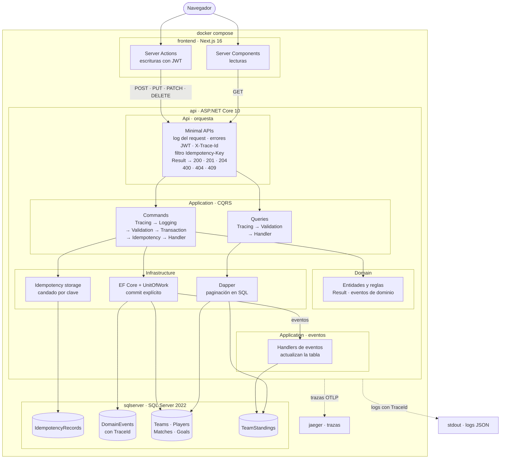

# FixtureHub

Sistema de gestión de torneos de fútbol: equipos, jugadores, calendario de partidos, registro de goles en vivo, tabla de posiciones y goleadores.

## Stack

| Área | Tecnología |
|---|---|
| Backend | .NET 10, C# 14, ASP.NET Core Minimal APIs |
| Arquitectura | Clean Architecture, CQRS con handlers propios |
| Escritura | EF Core + Unit of Work |
| Lectura | Dapper |
| Base de datos | SQL Server |
| Seguridad | JWT (lecturas públicas, escrituras con rol Admin) |
| Observabilidad | Serilog, CorrelationId/TraceId, OpenTelemetry + Jaeger |
| Frontend | Next.js 16 (App Router), React 19, TypeScript, Tailwind CSS 4 |
| Tests | xUnit, Testcontainers (SQL Server real), NetArchTest; Vitest en el frontend; colección de Postman con Newman |
| Infraestructura | Docker (imágenes multi-etapa sin root) + docker-compose con healthchecks |

## Arquitectura



- **Clean Architecture:** las dependencias de código apuntan hacia adentro (Api → Infrastructure → Application → Domain); las flechas del diagrama son el flujo de un request. Tests de arquitectura verifican la regla en el código compilado y en los `.csproj`.
- **CQRS:** los commands pasan por el dominio y se guardan con EF Core dentro de una transacción del Unit of Work; las queries leen con Dapper y paginan en SQL. No hay EF Core en la lectura ni Dapper en la escritura.
- **Pipeline de decorators** en cada command: traza, log, validación, transacción (el commit explícito lo hace el `TransactionDecorator`, nunca el handler) e idempotencia.
- **Eventos de dominio** despachados por el Unit of Work antes de guardar, en la misma transacción: actualizan la proyección de la tabla de posiciones y quedan registrados en `DomainEvents` con el TraceId del request.

El detalle, con el recorrido de una traza de punta a punta, está en [docs/arquitectura.md](docs/arquitectura.md).

## Estructura del repositorio

```
fixture-hub/
├── src/
│   ├── FixtureHub.Domain/          Reglas del torneo: entidades, estados, eventos, Result
│   ├── FixtureHub.Application/     Casos de uso (commands/queries) y contratos
│   ├── FixtureHub.Infrastructure/  EF Core, Dapper, SQL Server, seed, usuarios y hash de contraseñas
│   └── FixtureHub.Api/             Endpoints HTTP, middlewares, JWT, logs y trazas, composition root, Dockerfile
├── frontend/                       Next.js: páginas, server actions, idiomas es/en, cliente de la Api y Dockerfile
├── tests/
│   ├── FixtureHub.UnitTests/          Dominio, handlers y decorators, con fakes
│   ├── FixtureHub.IntegrationTests/   Persistencia, lecturas e idempotencia contra SQL Server en Docker; la Api por HTTP; logs y trazas
│   └── FixtureHub.ArchitectureTests/  Reglas de dependencia, visibilidad y convenciones
├── postman/                        Colección de Postman y su environment
├── docs/                           Arquitectura y decisiones de diseño
├── docker-compose.yml              SQL Server, Api, frontend y Jaeger
├── .env.example                    Variables opcionales de docker-compose para reemplazar las credenciales de demo (copiar como .env)
├── dotnet-tools.json               Herramientas locales (dotnet-ef)
├── Directory.Build.props           Configuración común (C# 14, nullable, warnings como errores)
├── global.json                     Versión fija del SDK de .NET
└── FixtureHub.slnx
```

## Cómo levantarlo

### Con Docker Compose

Requisitos: Docker Desktop (o Docker Engine con Compose v2) con al menos 4 GB de memoria para los contenedores; SQL Server pide 2 GB.

Desde la raíz del repositorio, sin configurar nada:

```bash
docker-compose up
```

O, para que corra en segundo plano y el comando vuelva cuando todo esté sano:

```bash
docker compose up -d --build --wait
```

La primera vez construye las imágenes (unos 3 minutos) y descarga SQL Server (unos 1,5 GB) si no está en la máquina. Los servicios arrancan en orden: SQL Server; después la Api, que aplica las migraciones, crea el administrador y carga el torneo de ejemplo; y al final el frontend.

**Credenciales de demo.** Sin un `.env`, el compose usa estos valores, pensados solo para probar en tu máquina (los puertos se abren únicamente en `127.0.0.1`):

| Para | Usuario | Contraseña o clave |
|---|---|---|
| Iniciar sesión en el frontend y en la Api | `admin` | `FixtureHub-Admin-2026` |
| SQL Server | `sa` | `FixtureHub-Sql-2026` |
| Firma de los JWT | — | `fixturehub-demo-signing-key-only-for-localhost` |

La zona horaria del torneo es `America/El_Salvador`. **No son secretos:** están publicados aquí a propósito. Para cualquier otro uso, copia [`.env.example`](.env.example) como `.env` y define valores propios: cada variable con valor reemplaza la de demo. El archivo explica los requisitos de cada una y trae comandos de PowerShell para generar valores aleatorios.

| Servicio | Dirección | Qué es |
|---|---|---|
| Frontend | `http://localhost:3000` | El sitio. Para administrar, inicia sesión con el usuario y la contraseña de arriba (o los de tu `.env`) |
| Api | `http://localhost:5065` | El mismo puerto que con `dotnet run`: [`FixtureHub.Api.http`](src/FixtureHub.Api/FixtureHub.Api.http) y la [colección de Postman](#colección-de-postman) funcionan igual |
| Jaeger | `http://localhost:16686` | Las trazas, bajo el servicio `fixturehub-api` |
| SQL Server | `localhost,1433` (usuario `sa`) | Para revisar la base con SSMS o Azure Data Studio |

Los puertos solo se abren en `127.0.0.1`. Si alguno está ocupado (por ejemplo, por `dotnet run` o `npm run dev`), detén ese proceso antes de levantar.

| Comando | Para qué |
|---|---|
| `docker compose ps` | Estado y salud de cada servicio |
| `docker compose logs -f api` | Logs de la Api (JSON, una línea por evento) |
| `docker compose down` | Detiene y borra los contenedores; los datos quedan en el volumen |
| `docker compose down -v` | Borra también la base: la próxima vez se crea de nuevo con el seed |

La contraseña de `sa` se fija la primera vez que se crea el volumen de SQL Server: si la cambias después (por ejemplo, al pasar de la de demo a la de tu `.env`), borra el volumen con `docker compose down -v`.

### En desarrollo, sin Docker

En Windows con SQL Server LocalDB (viene con Visual Studio).

**La primera vez**, configura el administrador y la clave con la que se firman los JWT. Se guardan con [user-secrets](https://learn.microsoft.com/aspnet/core/security/app-secrets), fuera del repositorio:

```bash
dotnet user-secrets set "Admin:Username" "admin" --project src/FixtureHub.Api
```

```bash
dotnet user-secrets set "Admin:Password" "<al menos 12 caracteres>" --project src/FixtureHub.Api
```

```bash
dotnet user-secrets set "Jwt:SigningKey" "<al menos 32 caracteres aleatorios>" --project src/FixtureHub.Api
```

Para generar una clave aleatoria en PowerShell:

```powershell
[Convert]::ToBase64String([Security.Cryptography.RandomNumberGenerator]::GetBytes(32))
```

Después:

```bash
dotnet run --project src/FixtureHub.Api --launch-profile http
```

En Development, la Api aplica las migraciones, crea el administrador y carga un torneo de ejemplo (6 equipos, 42 jugadores y 15 partidos, uno en curso) si la base está vacía. Queda en `http://localhost:5065`; el documento OpenAPI está en `/openapi/v1.json` y [`FixtureHub.Api.http`](src/FixtureHub.Api/FixtureHub.Api.http) tiene un ejemplo de cada endpoint, empezando por el login. Si falta un ajuste, la Api no arranca y el mensaje dice cuál.

Fuera de Development, los mismos valores llegan como variables de entorno: `Admin__Username`, `Admin__Password` y `Jwt__SigningKey` (ver [`.env.example`](.env.example)).

Para usar otro SQL Server, sobrescribe la cadena de conexión con una variable de entorno:

```bash
ConnectionStrings__FixtureHub="Server=localhost,1433;Database=FixtureHub;User Id=sa;Password=<tu-clave>;TrustServerCertificate=True" dotnet run --project src/FixtureHub.Api --launch-profile http
```

#### Frontend

Con la Api corriendo, en otra terminal (Node.js 24):

```bash
cd frontend
```

```bash
npm ci
```

```bash
npm run dev
```

Queda en `http://localhost:3000`. Las consultas son públicas; para administrar el torneo (equipos, jugadores, partidos y goles en vivo) se inicia sesión con el usuario y la contraseña de `Admin` configurados arriba. El selector **ES / EN** cambia el idioma.

El navegador nunca llama a la Api: las páginas y los formularios corren en el servidor de Next.js, que la llama en `http://localhost:5065`. Para cambiar la dirección o la zona horaria del torneo, copia [`frontend/.env.example`](frontend/.env.example) como `frontend/.env.local`:

| Variable | Por defecto | Uso |
|---|---|---|
| `API_BASE_URL` | `http://localhost:5065` | Dirección de la Api, leída al ejecutarse (en docker-compose, `http://api:8080`) |
| `TOURNAMENT_TIME_ZONE` | `America/El_Salvador` | Zona en la que se muestran y se capturan las fechas |

Para una versión de producción: `npm run build` y `npm start`.

#### Logs y trazas

Los logs salen por consola con [Serilog](https://serilog.net/): en Development como texto, y en cualquier otro entorno como JSON, una línea por evento (`Observability__JsonConsole=true` lo activa también en desarrollo). Cada request deja un log con método, ruta, status y duración, y cada log lleva el TraceId del request.

Para ver las trazas, levanta [Jaeger](https://www.jaegertracing.io/) en Docker:

```bash
docker run -d --name jaeger -p 16686:16686 -p 4317:4317 jaegertracing/jaeger:2.22.0
```

El perfil `http` ya apunta la Api a `http://localhost:4317` (`OTEL_EXPORTER_OTLP_ENDPOINT`). Las trazas aparecen en `http://localhost:16686` bajo el servicio `fixturehub-api`: el request HTTP, el command o la query y cada consulta SQL. Toda respuesta trae su TraceId en el header `X-Trace-Id`, para buscar la traza o los logs de ese request. Sin Jaeger, la Api funciona igual. Antes de levantar todo con Docker Compose, detén este contenedor (`docker stop jaeger`): usan los mismos puertos.

### La API en una mirada

| | |
|---|---|
| Lecturas | `GET /api/teams`, `/api/teams/{id}`, `/api/teams/{id}/players`, `/api/matches`, `/api/matches/{id}`, `/api/standings`, `/api/top-scorers`, con `pageNumber`, `pageSize` (máx. 100), `sortBy`, `sortDirection` y filtros. Los listados responden `{ data, pageNumber, pageSize, totalRecords, totalPages }` |
| Escrituras | POST, PUT, PATCH y DELETE sobre equipos, jugadores, partidos y goles |
| Autenticación | `POST /api/auth/login` devuelve un JWT (60 minutos). Las lecturas son públicas; las escrituras exigen `Authorization: Bearer <token>` con el rol Admin (401 sin token válido, 403 sin el rol) |
| Idempotencia | Todo POST exige el header `Idempotency-Key`; repetir la misma petición devuelve la respuesta original con `Idempotent-Replayed: true` |
| Errores | ProblemDetails (RFC 9457) con `errorCode`, `metadata` y `traceId` |
| Observabilidad | Header `X-Trace-Id` en toda respuesta; `traceparent` (W3C) se respeta; trazas en Jaeger |
| Salud | `GET /health/live` (el proceso responde) y `GET /health/ready` (además llega a SQL Server), fuera de `/api` y sin token |

El detalle está en [docs/arquitectura.md](docs/arquitectura.md#api-rest).

## Colección de Postman

[`postman/FixtureHub.postman_collection.json`](postman/FixtureHub.postman_collection.json) es un recorrido completo del torneo: 86 requests en orden, cada uno con sus verificaciones. El environment [`postman/FixtureHub.postman_environment.json`](postman/FixtureHub.postman_environment.json) tiene las variables `baseUrl` (`http://localhost:5065`, la misma con Docker Compose y con `dotnet run`), `adminUsername` y `adminPassword`.

1. Importa los dos archivos en Postman y elige el environment **FixtureHub local**.
2. `adminPassword` ya trae la contraseña de demo del compose (un test impide que tenga otra). Si levantaste con tu propio `.env` o con `dotnet run` (user-secrets), cámbiala en el environment.
3. Corre la colección completa con el Runner, o desde la terminal con [Newman](https://github.com/postmanlabs/newman):

```bash
npx newman@6.2.2 run postman/FixtureHub.postman_collection.json -e postman/FixtureHub.postman_environment.json
```

Con otra contraseña, agrega `--env-var "adminPassword=<la contraseña>"`.

| Carpeta | Qué recorre |
|---|---|
| 0. Salud | `/health/live` y `/health/ready` |
| 1. Autenticación | Login del administrador; el token queda para las escrituras |
| 2. Equipos · 3. Jugadores | CRUD, PUT repetido (idempotente), dorsales y filtros |
| 4. Partidos | Programar, reprogramar (PATCH), cancelar y eliminar; DELETE repetido |
| 5. Resultado en vivo | Iniciar, goles, autogol, anulación, finalizar, corrección del resultado y la tabla recalculada |
| 6. Reportes | Tabla de posiciones (verifica puntos, diferencia de gol y el orden) y goleadores |
| 7. Filtros y paginación | Páginas que no se repiten, página fuera de rango, filtros por país, estado, equipo y fechas, orden dinámico |
| 8. Idempotencia | Clave nueva, repetición con `Idempotent-Replayed`, clave reusada con otro body (409), sin clave y clave demasiado larga (400) |
| 9. Errores | 400 de validación, JSON mal formado y lista blanca de `sortBy`; 401; 404 con `traceparent` propio; 404 de una ruta inexistente y 405 con su `errorCode`; 409 por nombre, dorsal, horario, estado del partido y equipo con partidos pendientes |
| 10. Limpieza | Borra lo creado (borrado lógico): los equipos salen de la tabla y sus partidos quedan en el historial |

En **todas** las respuestas, un script de la colección verifica el header `X-Trace-Id`; en los errores, que sean ProblemDetails con `errorCode` y el mismo `traceId`; y en los listados, el contrato de paginación. Cada corrida usa un sufijo propio en los nombres y termina borrando lo que creó, así que se puede correr varias veces sobre la misma base. Un test de integración exige que cada endpoint de la Api tenga su request en la colección.

## Cómo correr los tests

Requisitos: SDK de .NET 10 y Docker Desktop encendido (los tests de integración levantan un SQL Server 2022 con [Testcontainers](https://dotnet.testcontainers.org/) y prueban la Api por HTTP con `WebApplicationFactory`).

```bash
dotnet tool restore
dotnet test
```

La primera corrida descarga las imágenes de SQL Server (unos 1,5 GB) y de Jaeger (unos 175 MB; un test exporta una traza a un Jaeger real). Para correr solo los tests que no necesitan Docker:

```bash
dotnet test tests/FixtureHub.UnitTests
dotnet test tests/FixtureHub.ArchitectureTests
```

| Proyecto | Tests | Qué cubre |
|---|---|---|
| `FixtureHub.UnitTests` | 306 | Dominio (reglas del partido, tabla, `Result`), handlers, validadores y decorators con fakes escritos a mano |
| `FixtureHub.IntegrationTests` | 204 | SQL Server real en Docker: EF Core, Unit of Work, idempotencia (incluidas las carreras), lecturas con Dapper, seed, la Api por HTTP, autorización, logs y trazas |
| `FixtureHub.ArchitectureTests` | 65 | Reglas de dependencia entre capas, CQRS (las queries no usan el lado de escritura ni los commands el de lectura), `SaveChanges` solo en el Unit of Work, visibilidad, convenciones, secretos fuera del repositorio, Docker, catálogos del frontend, Postman y documentación |
| `frontend` (Vitest) | 64 | Traducción, catálogos, errores de la Api, idioma, fechas, paginación, redirecciones y token |

Las pruebas mínimas que pide el enunciado:

| Pide el enunciado | Tests |
|---|---|
| Tabla de posiciones | `TeamStandingTests` (dominio); `TeamCreatedHandlerTests`, `MatchFinishedHandlerTests` y `MatchResultCorrectedHandlerTests` (la proyección); contra SQL Server, `StandingsProjectionTests` y `StandingsQueryTests` (orden, posición y filtros) |
| Cálculo de puntos | `TeamStandingTests.RecordResult_AddsOnePlayedAndThePointsOfTheOutcome` (victoria 3, empate 1, derrota 0) y `RecordResult_SeveralMatches_AccumulatesEverything` |
| Diferencia de gol | `TeamStandingTests.RecordResult_AddsTheGoalsAndTheGoalDifference`; el orden por diferencia, en `StandingsQueryTests` |
| Result Pattern | `ResultTests` y `ErrorTests`; `ProblemMappingTests` (de `Result` a 400, 404 y 409) |
| Idempotencia | `IdempotencyDecoratorTests` (unitarios: clave nueva, repetición, otra huella, vencida, en curso, por usuario); contra SQL Server, `IdempotencyTests`, `IdempotencyKeyFilterTests` y `ExpiredIdempotencyRecordsCleanupTests` |
| Commit del Unit of Work | `TransactionDecoratorTests` (commit si el handler sale bien; rollback si falla, si lanza o si el commit falla); contra SQL Server, `UnitOfWorkTests`; y `PersistenceTests`, que lee el código compilado y exige que el único tipo que llama a `SaveChanges` sea `UnitOfWork` |

Los tests de arquitectura incluyen `FrontendCatalogTests`: por reflexión, cada código de error de la Api debe tener su traducción en los catálogos del frontend (`frontend/src/i18n/messages/es.json` y `en.json`).

En el frontend (desde `frontend/`):

| Comando | Qué hace |
|---|---|
| `npm test` | Tests unitarios con Vitest: traducción, catálogos, errores de la Api, idioma, fechas, paginación, redirecciones y token |
| `npm run lint` | ESLint con las reglas de Next.js y de React |
| `npm run typecheck` | TypeScript estricto, con los tipos de las rutas que genera Next.js |
| `npm run format:check` | Prettier |

## Decisiones de diseño

Las principales, con su motivo completo en [docs/decisiones.md](docs/decisiones.md):

- **CQRS con handlers y decorators propios, sin MediatR.** El pipeline queda explícito y verificado por un test; las interfaces son de Application, así que cambiar de enfoque no toca los handlers.
- **La tabla de posiciones es una proyección** (`TeamStandings`) que actualizan los eventos de dominio en la misma transacción que el partido. La regla de puntos vive una sola vez, en C#; Dapper solo ordena y pagina.
- **Goles en vivo**, con autogol y anulación mientras el partido está en curso. Después de finalizado, el resultado solo cambia con una corrección que exige motivo y deja historial (PUT idempotente).
- **`Idempotency-Key` obligatorio en todo POST**, guardada en la misma transacción que los cambios, con un candado por clave (`sp_getapplock`) para los reintentos simultáneos y claves separadas por usuario.
- **La API devuelve códigos de error, no textos:** `errorCode` y `metadata` en ProblemDetails. El frontend traduce al español o al inglés, y un test verifica que cada código tenga traducción.
- **El CorrelationId es el TraceId W3C:** un solo identificador en logs, errores, `DomainEvents`, el header `X-Trace-Id` y Jaeger.
- **Lecturas públicas y escrituras con el rol Admin** (JWT HS256); los secretos nunca están en el repositorio.
- **El navegador nunca llama a la Api:** Next.js lee con Server Components y escribe con Server Actions; el JWT vive en una cookie `HttpOnly`.
- **Borrado lógico y DELETE idempotente:** un equipo eliminado sale de la tabla, pero sus partidos jugados quedan en el historial.

## Extensiones futuras

Detalladas en [docs/decisiones.md](docs/decisiones.md#extensiones-futuras): varios torneos con inscripción de equipos, jugadores en varios equipos (N:M), administración de usuarios y más roles, métricas y logs centralizados, goles empujados en tiempo real (SignalR o Server-Sent Events), trazas desde el servidor de Next.js, pruebas de punta a punta con Playwright y un pipeline de CI/CD que publique las imágenes.

## Documentación

- [Arquitectura](docs/arquitectura.md): diagrama, capas, regla de dependencias, flujo de un request, observabilidad, frontend y Docker.
- [Decisiones de diseño](docs/decisiones.md): qué se decidió y por qué, límites conocidos y extensiones futuras.
- [Guía de contribución](CONTRIBUTING.md): convención de commits, ramas y pull requests.
