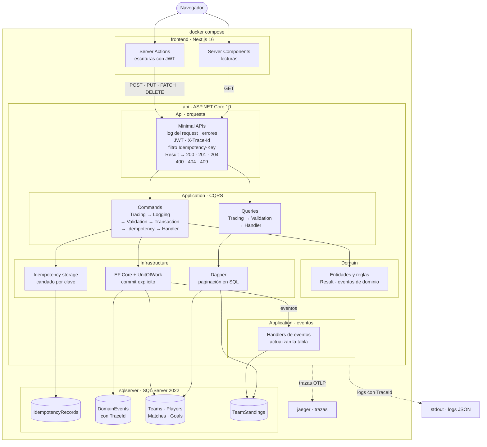
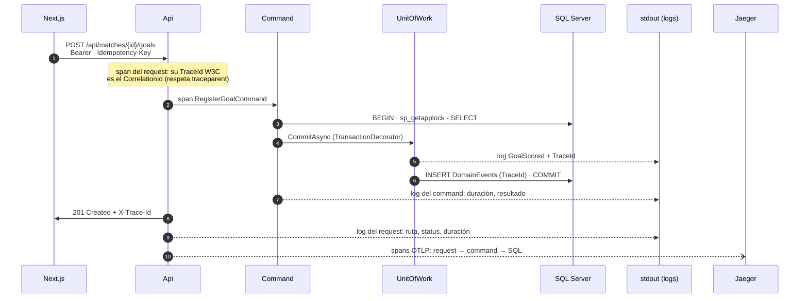

# Arquitectura

El backend de FixtureHub sigue **Clean Architecture**: el código se organiza en capas concéntricas y las dependencias de código **siempre apuntan hacia adentro**, hacia las reglas de negocio. El dominio no conoce la base de datos, el framework web ni ninguna librería de infraestructura.

```
┌─────────────────────────────────────────┐
│  Api                                    │
│  ┌───────────────────────────────────┐  │
│  │  Infrastructure                   │  │
│  │  ┌─────────────────────────────┐  │  │
│  │  │  Application                │  │  │
│  │  │  ┌───────────────────────┐  │  │  │
│  │  │  │  Domain               │  │  │  │
│  │  │  └───────────────────────┘  │  │  │
│  │  └─────────────────────────────┘  │  │
│  └───────────────────────────────────┘  │
└─────────────────────────────────────────┘
```

## Diagrama de arquitectura



Las flechas siguen el **flujo de un request** (quién llama a quién), no las dependencias de código: esas apuntan siempre hacia adentro, hacia Domain (ver [Capas](#capas)). Las líneas punteadas son la observabilidad: logs y trazas que salen de la Api.

| Lo que pide el enunciado | Dónde está en el diagrama |
|---|---|
| Capas | Los bloques Api, Application, Domain e Infrastructure dentro del contenedor `api` |
| CQRS | Dos caminos que no se cruzan: Commands → EF Core y Queries → Dapper |
| EF Core (escritura) | `EF Core + UnitOfWork`, al que solo llegan los commands |
| Dapper (lectura) | `Dapper`, al que solo llegan las queries; pagina en SQL |
| Unit of Work | `EF Core + UnitOfWork`: el `TransactionDecorator` hace el commit explícito y el Unit of Work despacha los eventos antes de guardar |
| Idempotency storage | `Idempotency storage` → tabla `IdempotencyRecords`, en la misma transacción que el command |
| Eventos | UnitOfWork → handlers de eventos → `TeamStandings`; cada evento queda en `DomainEvents` con el TraceId |
| Logs | `api` → stdout: JSON con el TraceId en cada evento |
| Trace flow | `api` → Jaeger por OTLP; el recorrido completo está en [Observabilidad](#recorrido-de-una-traza) |
| Frontend | `frontend · Next.js 16`: lee con Server Components y escribe con Server Actions |
| Docker | El bloque `docker compose`: frontend, api, sqlserver y jaeger en una red interna |

## Capas

| Proyecto | Responsabilidad | Depende de |
|---|---|---|
| `FixtureHub.Domain` | Reglas del torneo: entidades (`Team`, `Player`, `Match`, `Goal`), estados del partido, la fila de la tabla de posiciones (`TeamStanding`), eventos de dominio, errores y `Result` | Nada |
| `FixtureHub.Application` | Casos de uso: commands, queries, sus handlers y decorators. Define los **contratos** que necesita (`IUnitOfWork`, repositorios, lectores) sin implementarlos | Domain |
| `FixtureHub.Infrastructure` | Implementa los contratos: EF Core (escritura), Dapper (lectura), Unit of Work, idempotencia, seed, usuarios y hash de contraseñas | Application |
| `FixtureHub.Api` | Entrada HTTP con Minimal APIs, middlewares, filtros, JWT (emite y valida los tokens), mapeo de `Result` a HTTP, logs (Serilog) y trazas (OpenTelemetry) y *composition root* | Application, Infrastructure |

### Qué no puede aparecer en cada capa

- **Domain:** EF Core (ni sus atributos), Dapper, ASP.NET Core, logging. El mapeo a tablas se hace con Fluent API en Infrastructure.
- **Application:** EF Core, Dapper, SQL Server, `HttpContext`. Solo conoce interfaces.
- **Api:** lógica de negocio. Recibe el request, lo despacha y traduce el resultado a HTTP.
- **Domain, Application e Infrastructure:** Serilog y OpenTelemetry. Escriben logs con `ILogger<T>` y spans con `ActivitySource`, que son de .NET; la Api decide a dónde van.

## Inversión de dependencias

Application necesita persistir, pero no puede depender de Infrastructure. Por eso **Application define la interfaz e Infrastructure la implementa**:

```csharp
// FixtureHub.Application
public interface IUnitOfWork
{
    Task BeginTransactionAsync(CancellationToken cancellationToken);

    Task<Result> CommitAsync(CancellationToken cancellationToken);

    Task RollbackAsync(CancellationToken cancellationToken);
}

// FixtureHub.Infrastructure
internal sealed partial class UnitOfWork(FixtureHubDbContext context, ...) : IUnitOfWork { ... }
```

En tiempo de compilación, Infrastructure depende de Application. En tiempo de ejecución, Application invoca código de Infrastructure. La dependencia de código va en sentido contrario al flujo de control: ese es el principio de inversión de dependencias (la *D* de SOLID).

## Composition root

`Program.cs` es el único lugar donde se conectan las interfaces con sus implementaciones:

```csharp
builder.Services
    .AddApplication()
    .AddInfrastructure(connectionString)
    .AddApi(builder.Configuration);

var app = builder.Build();

await app.Services.InitializeDatabaseAsync(
    applyMigrations: app.Configuration.GetValue<bool>("Database:ApplyMigrations"),
    seed: app.Configuration.GetValue<bool>("Database:Seed"));
```

Por eso la Api referencia a Infrastructure. Las clases de Infrastructure son `internal`, así que los endpoints no pueden usarlas directamente; solo son públicas sus dos puertas de entrada (`AddInfrastructure` e `InitializeDatabaseAsync`) y las migraciones. Un test de arquitectura lo verifica, y otro impide que la Api use EF Core, Dapper o `SqlClient`.

## CQRS

Las escrituras y las lecturas siguen caminos distintos:

| | Commands (escritura) | Queries (lectura) |
|---|---|---|
| Acceso a datos | EF Core | Dapper |
| Pasa por el dominio | Sí: las entidades validan sus reglas | No: proyecta directamente a DTOs |
| Transacción | Unit of Work con commit explícito | No aplica |
| Paginación | No aplica | En SQL (`OFFSET/FETCH`), nunca en memoria |

Los handlers implementan interfaces propias (`ICommandHandler<TCommand>` e `ICommandHandler<TCommand, TResponse>`) y **no hay dispatcher**: el endpoint recibe por inyección el handler ya envuelto por los decorators. [Scrutor](https://github.com/khellang/Scrutor) registra los handlers por convención y aplica los decorators con `Decorate`; el último que se registra queda más afuera.

```
endpoint → ICommandHandler<CreateTeamCommand, Guid>
  TracingDecorator          un span con el nombre del comando y su resultado
  └ LoggingDecorator        nombre del comando, duración y resultado (nunca su contenido)
     └ ValidationDecorator   FluentValidation; si falla, 400 sin abrir la transacción
        └ TransactionDecorator  BEGIN → … → COMMIT, o ROLLBACK si algo falla
           └ IdempotencyDecorator  candado por clave, repite la respuesta guardada
              └ CreateTeamHandler  dominio + repositorios; nunca hace commit
```

- **El commit lo hace `TransactionDecorator`, nunca el handler.** Así la idempotencia guarda la respuesta en la misma transacción que los cambios, y ningún handler puede olvidar cerrarla.
- Los handlers y validadores son `internal`: nadie puede inyectarlos directo y saltarse el pipeline. Scrutor los registra como servicios con clave y solo expone la cadena decorada.
- Un test de arquitectura exige que cada command y cada query tengan exactamente un handler, y un test de inyección de dependencias fija el orden completo de la cadena.

Las queries tienen su propio contrato (`IQueryHandler<TQuery, TResponse>`) y un pipeline más corto: traza y validación. No abren transacción ni pasan por la idempotencia, porque no cambian nada.

```
endpoint → IQueryHandler<GetStandingsQuery, PagedResult<StandingItem>>
  TracingDecorator         un span con el nombre de la query
  └ ValidationDecorator    página, tamaño (1–100), sortBy en lista blanca, dirección
     └ GetStandingsHandler  delega en el lector; traduce "no existe" a un error del dominio
        └ IStandingsReader   (Application) ← StandingsReader con Dapper (Infrastructure)
```

### Lectura con Dapper

Application define los lectores (`ITeamReader`, `IMatchReader`, `IStandingsReader`, `ITopScorerReader`) y los modelos de lectura (records como `TeamSummary` o `StandingItem`). Infrastructure los implementa con Dapper sobre su propia conexión (`SqlConnectionFactory`), sin pasar por el `DbContext`.

Todas las listas usan `PagedSql`, que arma dos consultas en un solo viaje a la base (`QueryMultipleAsync`):

```sql
WITH [Rows] AS (<consulta base del lector>)
SELECT COUNT(*) FROM [Rows] WHERE <filtros>;

WITH [Rows] AS (<consulta base del lector>)
SELECT <columnas> FROM [Rows] WHERE <filtros>
ORDER BY <columna de la lista blanca> ASC|DESC, <desempate>
OFFSET @Offset ROWS FETCH NEXT @PageSize ROWS ONLY;
```

- **Lista blanca en dos niveles.** El validador rechaza un `sortBy` que no esté en `XxxQuery.SortFields` (400 `Query.InvalidSortBy`). El lector traduce ese nombre a una columna con su propio diccionario y lanza una excepción si no la encuentra: el texto del usuario nunca se concatena en el SQL. Un test verifica que las dos listas coincidan.
- **Filtros siempre parametrizados**, y solo se agregan los que llegan (sin `@x IS NULL OR …`). En `LIKE`, los comodines del usuario (`%`, `_`, `[`) se escapan: buscar `50%` encuentra el texto literal.
- **Orden total:** cada lista agrega un desempate único (el Id o la posición). Sin eso, `OFFSET/FETCH` puede repetir o saltar filas entre páginas.
- **El offset es `long`:** con `pageNumber` muy grande, `(pageNumber - 1) * pageSize` desbordaría un `int` y SQL Server rechazaría el offset negativo.
- **La posición en la tabla** se calcula con `ROW_NUMBER()` dentro del CTE, antes del filtro por nombre: filtrar no renumera la tabla. **Los goleadores** usan `RANK()`: los empatados comparten posición y la siguiente se salta (1, 1, 3).

### La tabla de posiciones es una proyección

La tabla no se calcula en cada consulta: es un **modelo de lectura** (tabla `TeamStandings`) que la escritura mantiene al día con los eventos de dominio, dentro de la misma transacción.

```
match.Finish()  ──▶  MatchFinished(local, visitante, 2, 1)
                         │   el Unit of Work despacha el evento antes del commit
                         ▼
     TeamStanding(local).RecordResult(2, 1)       → +3 puntos
     TeamStanding(visitante).RecordResult(1, 2)   → +0 puntos

GET /api/standings  ──▶  Dapper: ORDER BY Points DESC, GoalDifference DESC, GoalsFor DESC, Name
                                  OFFSET / FETCH
```

| Evento | Efecto en la tabla |
|---|---|
| `TeamCreated` | Crea la fila del equipo en cero, para que aparezca aunque no haya jugado |
| `MatchFinished` | `RecordResult` para cada equipo, con su marcador |
| `MatchResultCorrected` | `RevertResult` con el marcador anterior y `RecordResult` con el nuevo |

- **La regla de puntos vive una sola vez, en C#** (`TeamStanding`), y se probó con TDD. Dapper solo ordena y pagina; no calcula puntos.
- Puntos y diferencia de gol se guardan como columnas para poder ordenar e indexar en SQL sin repetir la fórmula.
- Como la tabla se actualiza en la **misma transacción** que el partido, no hay consistencia eventual: si algo falla, se revierte todo.
- Si la proyección se desincronizara (por ejemplo, por un cambio manual en la base), se puede reconstruir recorriendo los partidos `Finished`.
- Se descartó calcular la tabla con SQL en cada consulta: la regla de puntos habría quedado duplicada, en el SQL y en C#.

### Despacho de eventos de dominio

Los agregados acumulan sus eventos en memoria (`Raise`). Al confirmar, el Unit of Work:

1. Busca en el `ChangeTracker` de EF Core los agregados con eventos pendientes y los vacía.
2. Por cada evento, agrega una fila a la tabla `DomainEvents` (tipo, JSON, fecha y TraceId del request) y lo entrega a `IDomainEventDispatcher`, que llama a todos los `IDomainEventHandler<TEvento>` registrados.
3. Repite mientras aparezcan eventos nuevos (un handler podría generar otros).
4. Llama a `SaveChanges` y confirma la transacción: el cambio, la proyección y el registro de eventos se guardan juntos o no se guarda nada.

Los handlers de eventos viven en Application (`Standings/`) y Scrutor los registra igual que los de comandos. Un evento sin handlers (por ejemplo, `GoalScored`) solo queda registrado en `DomainEvents`.

## Idempotencia

Tiene dos partes, una en cada capa:

| Parte | Capa | Qué hace |
|---|---|---|
| `IdempotencyKeyFilter` | Api | Filtro de endpoint aplicado al grupo `/api`. En los POST exige el header `Idempotency-Key` (400 `Idempotency.KeyRequired` si falta, está vacío o viene repetido; 400 `Idempotency.KeyTooLong` si supera 100 caracteres) y lo copia a `IdempotencyContext.Key`. Al volver, si la respuesta fue repetida, agrega el header `Idempotent-Replayed: true`. Los demás métodos pasan sin revisar. |
| `IdempotencyDecorator` | Application | La lógica: candado, huella, repetir o ejecutar y guardar. Solo actúa si `IdempotencyContext.Key` tiene valor. |

Como el filtro está en el grupo, ningún POST puede olvidarlo; un test recorre todos los POST registrados y verifica que rechacen el request sin clave.

`IdempotencyDecorator` corre **dentro** de la transacción:

```
BEGIN TRANSACTION
  sp_getapplock 'idempotency:{clave}' (LockOwner = Transaction, espera hasta 10 s)
  ¿existe la clave y no venció?   misma huella → devuelve el valor guardado, sin ejecutar
                                  otra huella  → 409 Idempotency.KeyReused
  si no → ejecuta el handler → si tuvo éxito, agrega la fila de la clave
COMMIT  (la clave y los cambios del comando se confirman juntos; el candado se libera solo)
```

- **Huella:** SHA-256 del nombre completo del comando y su JSON. Distingue "el mismo pedido repetido" de "la clave reusada con otro contenido".
- **Se guarda el valor del `Result`** (por ejemplo, el Id creado), no la respuesta HTTP, y solo de los éxitos. Un fallo hizo rollback, así que repetirlo es seguro.
- **Mismo pedido en paralelo:** el segundo espera en el candado a que el primero termine y recibe su respuesta. Si la espera supera 10 s, 409 `Idempotency.RequestInProgress`.
- Las claves expiran a las 24 horas; una clave vencida se reemplaza: la fila vieja se borra con un `DELETE` inmediato dentro de la transacción y la nueva se inserta al confirmar.
- **Limpieza periódica:** `ExpiredIdempotencyRecordsCleanup`, un `BackgroundService` de Infrastructure, borra las claves vencidas al arrancar la Api y después cada hora, en lotes de 1000 empezando por las más viejas (con el índice por `ExpiresAt`), para no bloquear la tabla entera con un solo `DELETE` grande. Si la base falla, registra el error y lo intenta en el ciclo siguiente: una excepción sin atrapar en un `BackgroundService` detiene la Api.
- **La limpieza y el reemplazo pueden coincidir:** un request encuentra su clave vencida y, antes de reemplazarla, la limpieza la borra. Por eso el reemplazo borra con `ExecuteDelete`, que acepta borrar 0 filas, en lugar de marcar la entidad como borrada (EF Core esperaría 1 fila y lanzaría `DbUpdateConcurrencyException`). La lectura de la clave es `AsNoTracking` para que la fila nueva no choque con la vieja en el seguimiento de EF Core. Un test reproduce esa carrera paso a paso.
- **Claves por usuario:** el filtro copia el usuario del token (`sub`) a `IdempotencyContext.Scope` y la clave se guarda como `{usuario}:{clave}`. Dos usuarios pueden usar la misma clave sin chocar, y ninguno recibe la respuesta guardada del otro. Los errores (`metadata.key`) muestran la clave que mandó el cliente, sin el prefijo.

## API REST

Minimal APIs agrupadas por recurso (`MapGroup`), todas bajo `/api`:

| Recurso | Endpoints |
|---|---|
| Autenticación | `POST /auth/login` |
| Equipos | `GET /teams`, `GET /teams/{teamId}`, `POST /teams`, `PUT /teams/{teamId}`, `DELETE /teams/{teamId}` |
| Jugadores | `GET /teams/{teamId}/players`, `POST /teams/{teamId}/players`, `PUT /teams/{teamId}/players/{playerId}`, `DELETE /teams/{teamId}/players/{playerId}` |
| Partidos | `GET /matches`, `GET /matches/{matchId}`, `POST /matches`, `PATCH /matches/{matchId}`, `DELETE /matches/{matchId}`, `POST /matches/{matchId}/start`, `/finish`, `/cancel` |
| Goles y resultado | `POST /matches/{matchId}/goals`, `POST /matches/{matchId}/goals/{goalId}/annul`, `PUT /matches/{matchId}/result` |
| Reportes | `GET /standings`, `GET /top-scorers` |

Fuera de `/api` están los health checks, `GET /health/live` y `GET /health/ready` (ver [Docker](#docker)).

Cada endpoint hace tres cosas y nada más: arma el command o la query con lo que llega por la ruta, el body y la query string; pide el handler por inyección, y traduce el `Result`:

| `Result` | HTTP |
|---|---|
| Éxito de una creación | 201 Created, `Location` y `{ "id": "…" }` |
| Éxito sin respuesta | 204 No Content |
| Éxito de una lectura | 200 OK con el modelo de lectura |
| `ErrorType.Validation` / `NotFound` / `Conflict` / `Failure` | 400 / 404 / 409 / 500 como ProblemDetails |

**ProblemDetails (RFC 9457).** Todo error sale con el mismo formato, venga de un `Result`, de una excepción o de una ruta inexistente:

```json
{
  "type": "https://tools.ietf.org/html/rfc9110#section-15.5.10",
  "title": "Conflict",
  "status": 409,
  "detail": "El dorsal 10 ya pertenece a otro jugador del equipo.",
  "instance": "/api/teams/…/players",
  "errorCode": "Player.ShirtNumberTaken",
  "metadata": { "shirtNumber": 10 },
  "traceId": "4bf92f3577b34da6a3ce929d0e0e4736"
}
```

- `ProblemMapping` convierte un `Error` en ProblemDetails; `ProblemDetailsEnricher` (el `CustomizeProblemDetails` de ASP.NET Core) agrega a **todas** las respuestas de error el `instance` y el `traceId`, y el `errorCode` a las que no pasaron por un `Result`: 401 `Auth.Unauthenticated`, 403 `Auth.Forbidden`, 404 `Route.NotFound` (ruta inexistente) y 405 `Route.MethodNotAllowed`. Un 404 de un handler conserva su propio código (`Team.NotFound`).
- El `traceId` son los 32 caracteres del trace W3C, el mismo valor que se guarda en la tabla `DomainEvents`. Si el cliente manda un header `traceparent`, se respeta.
- `GlobalExceptionHandler` (`IExceptionHandler`): un body o un parámetro mal formado (JSON inválido, `"diez"` en un número) es 400 `Request.Malformed`; cualquier otra excepción es 500 `Server.Unexpected`, sin el mensaje de la excepción. `RouteHandlerOptions.ThrowOnBadRequest = true` hace que los errores de binding también pasen por ahí, en todos los entornos.

## Seguridad

Las lecturas (`GET`) son públicas. Las escrituras (`POST`, `PUT`, `PATCH`, `DELETE`) exigen un JWT con el rol `Admin` en el header `Authorization: Bearer <token>`.

```
POST /api/auth/login { username, password }
 → [Application] IQueryHandler<LoginQuery, AuthToken>: Validation → LoginHandler
     IUserReader (Dapper: Users)  →  IPasswordHasher.Verify (PBKDF2)  →  ITokenIssuer.Issue
 ← 200 { accessToken, tokenType: "Bearer", expiresAt }      401 Auth.InvalidCredentials

POST /api/teams  (Authorization: Bearer …)
 → UseAuthentication: JwtBearer valida firma (HS256), emisor, audiencia y vencimiento → HttpContext.User
 → UseAuthorization: el endpoint pide el rol Admin → 401 Auth.Unauthenticated / 403 Auth.Forbidden
 → filtro Idempotency-Key (clave por usuario) → endpoint → command
```

| Pieza | Capa | Qué hace |
|---|---|---|
| `LoginQuery`, `LoginHandler`, `LoginValidator`, `AuthToken` | Application | El caso de uso. Es una **query**: no cambia estado, así que no abre transacción ni usa idempotencia (pasa solo por los decorators de traza y validación). |
| `IUserReader`, `IPasswordHasher`, `ITokenIssuer` | Application | Contratos que necesita el login |
| `UserReader` | Infrastructure | Lee el usuario con Dapper |
| `Pbkdf2PasswordHasher` | Infrastructure | PBKDF2-HMAC-SHA256, 600.000 iteraciones, sal aleatoria de 16 bytes, comparación en tiempo constante. Guarda `PBKDF2-SHA256$iteraciones$sal$hash`, así que se pueden subir las iteraciones sin invalidar los hashes viejos. |
| `AdminAccountInitializer` | Infrastructure | Al iniciar, crea el administrador de `Admin:Username` / `Admin:Password` si no existe, o actualiza su hash si la contraseña cambió |
| `JwtOptions`, `JwtTokenIssuer` | Api | Emiten el token. Las mismas opciones construyen los `TokenValidationParameters`, así que emisor y validador no pueden quedar desalineados. |
| `AddJwtAuthentication` | Api | `JwtBearer` + autorización; valida la configuración al arrancar (`ValidateOnStart`) |
| `RequireAdminForWrites` | Api | Convención del grupo `/api`: todo endpoint que no sea solo `GET` recibe `[Authorize(Roles = "Admin")]`. Un endpoint nuevo queda protegido sin acordarse. |
| `ProblemDetailsEnricher` | Api | El 401 y el 403 del middleware salen como ProblemDetails con `errorCode` (`Auth.Unauthenticated`, `Auth.Forbidden`); también el 404 de una ruta inexistente (`Route.NotFound`) y el 405 (`Route.MethodNotAllowed`) |

- **Token:** HS256, 60 minutos (`Jwt:ExpirationMinutes`), con `sub` (Id del usuario), `name`, `role` y `jti`. Se valida firma, algoritmo (solo HS256: un token `alg: none` se rechaza), emisor, audiencia y vencimiento con 30 s de tolerancia. `MapInboundClaims = false` deja los claims con sus nombres JWT.
- **El login no revela qué usuarios existen:** usuario inexistente y contraseña incorrecta dan la misma respuesta, y en los dos casos se calcula un PBKDF2 para que el tiempo de respuesta tampoco los distinga.
- **El login queda fuera del filtro de idempotencia:** está en su propio grupo, porque repetirlo no cambia nada.
- **Secretos fuera del repositorio:** `Admin:Password` y `Jwt:SigningKey` vienen de user-secrets en desarrollo o de variables de entorno (`Admin__Password`, `Jwt__SigningKey`; Docker Compose las toma de un `.env`). Si faltan o son débiles (contraseña de menos de 12 caracteres, clave de menos de 32 bytes), la Api no arranca y el mensaje nombra el ajuste. Un test impide que aparezcan en los `appsettings*.json`.

## Observabilidad

Tres piezas, todas conectadas por el mismo identificador: el **TraceId W3C** del request (32 caracteres hexadecimales).

```
HTTP (traceparent opcional)
 → UseSerilogRequestLogging   mide todo el request y al final escribe un log: método, ruta, status, duración, usuario
 → UseExceptionHandler → UseStatusCodePages → UseAuthentication
 → CorrelationMiddleware      header X-Trace-Id en la respuesta; el usuario (sub) en cada log del request
 → UseAuthorization → endpoint
 → [Application] TracingDecorator → LoggingDecorator → …   span y logs del command o la query
 → [Infrastructure] Unit of Work: cada evento de dominio va al log, a la tabla DomainEvents y al span
```

### Logs: Serilog

- El código escribe con `ILogger<T>` y mensajes generados con `[LoggerMessage]`; **Serilog es solo el proveedor**, configurado en la Api (`AddStructuredLogging`). Ninguna otra capa lo referencia (dos tests lo verifican: en el código compilado y en los `.csproj`).
- **Salida:** consola. En Development, texto legible con el TraceId al final de cada línea; en cualquier otro entorno (`Observability:JsonConsole`), JSON compacto, un evento por línea, listo para que lo indexe Docker, Loki, Seq o Elastic.
- **Un log por request** (`UseSerilogRequestLogging`), con `RequestMethod`, `RequestPath`, `StatusCode`, `Elapsed` (ms), `Route` (la plantilla, por ejemplo `/api/teams/{teamId:guid}`) y `UserId` si el request vino con token. Reemplaza a los logs de ASP.NET Core (nivel `Warning`). Un 5xx sale como `Error`; un 4xx, como `Information`: es un error del cliente, no del servidor. Los health checks salen como `Verbose`, es decir, no salen: Docker los consulta cada 10 segundos.
- **Niveles** en la sección `Serilog` de `appsettings.json` (se pueden cambiar con variables de entorno, por ejemplo `Serilog__MinimumLevel__Default=Debug`). Los comandos SQL de EF Core quedan en `Warning`: el SQL se ve en las trazas. Se usan los cuatro niveles: `Error` (una excepción inesperada, un 5xx o un health check que falla), `Warning` (un command rechazado), `Information` (cada request, cada command y cada evento de dominio) y `Debug` (el Unit of Work: transacción abierta, confirmada con la cantidad de cambios, o revertida). `Debug` está encendido para el código de FixtureHub en Development (`Serilog:MinimumLevel:Override:FixtureHub`); en Docker se enciende con `Serilog__MinimumLevel__Override__FixtureHub=Debug`.
- **Nunca se loguea** el contenido de un command, el body, la contraseña ni el token. `RequestPath` no incluye la query string.
- Un test de arquitectura impide usar en las plantillas nombres que ya pone el pipeline (`EventId`, `SourceContext`, `Scope`, `UserId`, `Route`): con Serilog, un `{EventId}` en el mensaje queda pisado por el `EventId` de `[LoggerMessage]`.

### Correlación: un solo identificador

| Dónde | Cómo aparece |
|---|---|
| Request entrante | Header `traceparent` (W3C Trace Context). Si viene, ASP.NET Core continúa esa traza; si no, crea una. |
| Respuesta | Header `X-Trace-Id`, en todas: 200, 401, 404 y también 500. Se escribe con `Response.OnStarting`, porque el manejador de excepciones borra los headers antes de escribir el error. |
| Errores | `traceId` en el ProblemDetails |
| Logs | `@tr` (y `@sp`, el span) en el JSON de cada evento: Serilog los toma de `Activity.Current` |
| Base de datos | Columna `TraceId` de `DomainEvents` |
| Trazas | Es el Id de la traza en Jaeger |

El *CorrelationId* de FixtureHub **es** el TraceId: no hay un segundo identificador que mantener sincronizado. Con el valor de `X-Trace-Id` (o del `traceId` de un error) se encuentran la traza en Jaeger, todos los logs de ese request y los eventos de dominio que generó.

### Recorrido de una traza

Un gol registrado desde el frontend, de punta a punta. Todo lo que deja el request (logs, fila en `DomainEvents`, spans y el header de la respuesta) lleva el mismo TraceId.



Con el valor de `X-Trace-Id` se encuentran la traza en Jaeger (búsqueda por Trace ID), los logs del request (`docker compose logs api` filtrando por `@tr`) y el evento `GoalScored` en la tabla `DomainEvents`.

### Trazas: OpenTelemetry + Jaeger

```
POST /api/teams/                      span del servidor (ASP.NET Core)
└ CreateTeamCommand                   TracingDecorator (Application)   evento: TeamCreated
  ├ EXEC sp_getapplock …              SqlClient (EF Core y Dapper usan el mismo driver)
  ├ SELECT [IdempotencyRecords]
  ├ SELECT [Teams]
  └ INSERT …                          SaveChanges: equipo, fila de la tabla, evento, clave
```

| Fuente | Qué produce |
|---|---|
| `AddAspNetCoreInstrumentation` | Un span por request, con método, ruta, status y el `traceparent` entrante como padre. Los health checks se filtran: ni su span ni sus hijos se registran |
| `ApplicationTracing` (`ActivitySource` de Application) | Un span por command o query (`TracingDecorator`, el más externo del pipeline), con `fixturehub.operation` (`command`/`query`), `fixturehub.result` (`success`/`rejected`) y `fixturehub.error_code`. Los eventos de dominio se agregan como eventos del span (`fixturehub.event_id`). |
| `AddSqlClientInstrumentation` | Un span por comando SQL, con el texto resumido y sin los valores de los parámetros |

- Application usa `System.Diagnostics.ActivitySource`, que es parte de .NET: no depende de OpenTelemetry. La Api lo suscribe con `AddSource(ApplicationTracing.SourceName)`.
- **Un comando rechazado (400, 404, 409) no marca el span como error:** queda con `fixturehub.result = rejected` y el código. Solo una excepción lo marca (`Error`, con el evento `exception`), igual que el span del servidor solo es error con un 5xx.
- **Exportación por OTLP**, el protocolo estándar de OpenTelemetry, que Jaeger recibe de forma nativa (puerto 4317). El endpoint se configura con la variable estándar `OTEL_EXPORTER_OTLP_ENDPOINT`; si no está, no se exporta (los tests y una máquina sin Jaeger no intentan conectarse). El perfil `http` de `launchSettings.json` apunta a `http://localhost:4317`.
- Si Jaeger no responde, el exportador descarta en segundo plano: la Api no se entera ni se frena.
- El servicio se llama `fixturehub-api`. El arranque (migraciones, administrador y seed) no deja trazas: corre antes de `app.Run()`, y OpenTelemetry empieza a escuchar cuando arranca el host. Sí deja logs.

## Frontend

Next.js 16 con App Router. El servidor de Next.js es el único cliente de la Api: el navegador habla con Next.js y Next.js habla con la Api.

```
Navegador ──HTML / RSC──▶ Next.js (servidor) ──HTTP + JSON──▶ Api ──▶ SQL Server
          ◀── formularios (Server Actions, POST) ─┘     ▲
                cookie HttpOnly con el JWT              └ Authorization: Bearer, Idempotency-Key
```

- **Lecturas:** cada página es un *Server Component* que lee los parámetros de la URL, llama a la Api y devuelve HTML ya armado.
- **Escrituras:** los formularios llaman a *Server Actions* (funciones `"use server"`), que agregan el token y la clave de idempotencia y llaman a la Api.
- **Consecuencias:** no hace falta CORS; el JWT nunca llega a JavaScript del navegador; la dirección de la Api (`API_BASE_URL`) se lee al ejecutarse, así que la misma imagen sirve para cualquier entorno.

| Carpeta | Qué contiene |
|---|---|
| `src/app/` | Rutas: cada carpeta es un segmento de la URL y su `page.tsx` es la página (`/standings`, `/teams/[teamId]`, …). `layout.tsx` es el marco común; `not-found.tsx` y `error.tsx` son las páginas de error |
| `src/actions/` | Server Actions: `auth.ts` (login y logout), `teams.ts`, `matches.ts`, `locale.ts`; `support.ts` traduce la respuesta de la Api al estado del formulario |
| `src/components/` | Componentes de la interfaz. Los de `forms/` son *Client Components* (`"use client"`): manejan el estado del formulario |
| `src/lib/api/` | Cliente HTTP (solo servidor), tipos de la Api, lecturas tipadas y conversión de ProblemDetails |
| `src/lib/auth/` | Sesión: la cookie con el JWT y la lectura de sus datos para la interfaz |
| `src/i18n/` | Idiomas: catálogos `es.json` (fuente de verdad) y `en.json`, traducción y negociación del idioma |

### Una lectura: `GET /standings?sortBy=points&sortDirection=desc`

```
Navegador → Next.js
 → app/standings/page.tsx (Server Component)
     parseListParams: página, tamaño (10, 25, 50) y orden en lista blanca; lo inválido vuelve al valor por defecto
     getStandings → apiGet → fetch GET {API_BASE_URL}/api/standings?… (sin caché)
 ← ApiResult: { ok: true, data } → tabla, encabezados ordenables y paginación (todo son enlaces con la URL nueva)
              { ok: false, problem } → ProblemAlert: mensaje traducido + código de seguimiento (traceId)
```

Los filtros, el orden y la página viven en la URL: se pueden compartir, el botón Atrás funciona y el formulario de filtros es un `GET` normal (`next/form`) que no necesita JavaScript.

### Una escritura: registrar un gol

```
Navegador: RegisterGoalForm (Client Component, useActionState)
   hidden idempotencyKey = la que generó el servidor al renderizar la página
 → POST a la misma página (Server Action registerGoal; Next compara Origin con Host)
 → actions/matches.ts: valida que matchId sea un Guid, lee el formulario
 → apiWrite: token de la cookie HttpOnly (sin token → 401 sin llamar a la Api)
     POST /api/matches/{id}/goals  Authorization: Bearer …  Idempotency-Key: …
 → settle:
     éxito → refresh(): la misma respuesta trae la página con el marcador nuevo; la clave se renueva
     401   → borra la cookie y redirige a /login?expired=1&returnTo=<página actual>
     otro  → devuelve { problem, values, idempotencyKey } al formulario: errores por campo, datos conservados, misma clave
```

| Tema | Cómo |
|---|---|
| Sesión | El JWT del login va a una cookie `HttpOnly`, `Secure`, `SameSite=Lax`, que vence cuando vence el token. El servidor lee del token solo `name`, `role` y `exp` para mostrar la interfaz de Admin; **la firma la valida la Api** en cada escritura |
| Idempotencia | La clave nace con el formulario y se reutiliza en cada reintento hasta que la operación sale bien (la Api solo guarda las respuestas exitosas). Dos envíos seguidos del mismo formulario producen un solo gol: el segundo recibe la respuesta guardada |
| Errores | La Api devuelve códigos; el frontend los traduce con `error.{errorCode}` y los valores de `metadata`. Un código sin traducción muestra un mensaje genérico, nunca la clave. Si la Api no responde: `Network.Unavailable` |
| Idiomas | Cookie elegida con el selector → `Accept-Language` del navegador → español. `<html lang>` cambia con el idioma |
| Fechas | Se muestran y se capturan en la zona del torneo (`TOURNAMENT_TIME_ZONE`); a la Api viajan en UTC |
| En vivo | Mientras hay partidos en curso, la página se vuelve a pedir al servidor cada 10 s (15 s en el inicio) con `router.refresh()`; se pausa si la pestaña está oculta |
| Errores inesperados | `error.tsx` muestra un mensaje y el `digest` para buscar el error en los logs del servidor; `not-found.tsx` responde con un 404 real |

### Qué se prueba en el frontend

- **Vitest** (`npm test`): traducción e interpolación, catálogos (mismas claves y mismos marcadores en los dos idiomas), conversión de ProblemDetails, mensajes de error con estados y fechas, negociación del idioma, fechas con zona horaria (incluido un cambio de horario de verano), paginación y orden, redirecciones seguras después del login, lectura del token e `isGuid`.
- **TypeScript estricto:** `t("clave")` solo acepta claves que existen en `es.json`, y `en.json` debe tener todas las claves de `es.json`.
- **.NET** (`FrontendCatalogTests`, en los tests de arquitectura): cada código de error de Domain, Application, Infrastructure y Api tiene traducción en los dos catálogos, cada estado del partido también, los marcadores de un mensaje existen en la `metadata` de su error, y los errores constantes (los que llegan por campo, sin `metadata`) escriben sus límites en el texto y coinciden con los del dominio.

## Base de datos al iniciar

`InitializeDatabaseAsync` aplica las migraciones (`Database:ApplyMigrations`), asegura el usuario administrador (siempre) y carga el seed (`Database:Seed`). Las dos opciones están apagadas en `appsettings.json` y encendidas en Development y en docker-compose.

El seed (`DatabaseSeeder`) **no inserta filas a mano**: envía los mismos commands que la API (crear equipos y jugadores, programar, iniciar, registrar goles, anular, finalizar, cancelar), cada uno en su propio scope, como si fueran requests. Pasan por validación, transacción y eventos, así que la tabla de posiciones se arma sola y ninguna regla del dominio se salta. Solo corre si la base no tiene equipos.

## Persistencia

- **Fluent API** en `Infrastructure/Persistence/Configurations`, un archivo por entidad. El dominio no tiene atributos de EF Core.
- **Colecciones encapsuladas:** EF Core lee y escribe los campos privados (`_players`, `_goals`, `_corrections`); las propiedades públicas son de solo lectura.
- **Borrado lógico** con filtro global (`HasQueryFilter`) en las raíces `Team` y `Match`. `IgnoreQueryFilters()` se usa solo para el `DELETE` idempotente.
- **Índices únicos filtrados** (`WHERE [IsDeleted] = 0`): nombre de equipo y dorsal por equipo. Un nombre o dorsal liberado por un borrado se puede reutilizar.
- **Choques con índices únicos** (errores 2601/2627 de SQL Server): `UniqueIndexViolation` los traduce a `Team.NameTaken` o `Player.ShirtNumberTaken`. Son la red de seguridad para dos requests simultáneos que pasan juntos la verificación del handler.
- **Migraciones** con `dotnet-ef` como herramienta local (`dotnet tool restore`). Se aplican al iniciar la Api en Development y al iniciar la base de los tests de integración, así que un modelo sin migración rompe los tests.
- **Una advertencia de EF Core que indica un bug falla:** un `Take` o `Skip` sin `OrderBy` lanza una excepción en lugar de solo advertir (`ConfigureWarnings`), igual que los warnings del compilador son errores.

## Docker

`docker compose up -d --build --wait` levanta cuatro servicios en una red interna:

```
               127.0.0.1:3000               127.0.0.1:5065                  127.0.0.1:1433
Navegador ──▶ frontend (Next.js) ──HTTP──▶ api (ASP.NET Core) ──TDS──▶ sqlserver (SQL Server 2022)
                         API_BASE_URL=http://api:8080   │    Server=sqlserver,1433
                                                        │
                                                        └──OTLP──▶ jaeger (UI en 127.0.0.1:16686)
                                     OTEL_EXPORTER_OTLP_ENDPOINT=http://jaeger:4317
```

Dentro de la red, cada servicio encuentra a los demás por su nombre (`api`, `sqlserver`, `jaeger`): Docker tiene un DNS interno. Los puertos publicados solo sirven para entrar desde la máquina, y están atados a `127.0.0.1` para que nadie de la red local llegue a ellos. La Api se publica en el 5065, el mismo de `dotnet run`, así que `FixtureHub.Api.http` y Postman funcionan igual con los dos.

### Arranque en cadena

| Servicio | Espera a | Está sano cuando |
|---|---|---|
| `sqlserver` | — | `sqlcmd` ejecuta `SELECT 1` |
| `api` | `sqlserver` sano | `GET /health/ready` responde 200 |
| `frontend` | `api` sana | `GET /health` responde 200 |
| `jaeger` | — | Sin healthcheck: la Api funciona aunque Jaeger no esté |

`depends_on` con `condition: service_healthy` ordena el arranque, y `--wait` devuelve el control cuando todo está sano (o falla si algo no lo logra). La Api aplica las migraciones, asegura el administrador y carga el seed **antes** de que Kestrel empiece a escuchar, así que cuando `/health/ready` responde, la base ya está lista. Los healthchecks usan `start_interval` (cada 2 s durante el arranque y cada 10 s después) para no esperar de más.

### Health checks de la Api

| Endpoint | Qué verifica | Para qué |
|---|---|---|
| `GET /health/live` | Nada: si el proceso responde, está vivo | Reiniciar un proceso colgado. No consulta la base: si SQL Server cae, reiniciar la Api no lo arregla |
| `GET /health/ready` | Todos los checks registrados; hoy, que el `DbContext` se conecte a SQL Server (`AddDbContextCheck`) | Decidir si se le manda tráfico. Es el que usa Docker |

- Responden `Healthy` (200) o `Unhealthy` (503) en texto plano, sin token y con `Cache-Control: no-store`. Están fuera de `/api`, así que no pasan por la autorización ni por la idempotencia.
- **No generan log de request ni traza:** `GetLevel` los baja a `Verbose` y el filtro de la instrumentación de ASP.NET Core los descarta. Si un check falla, el servicio de health checks escribe un `Error` con el nombre del check y la excepción.
- El check se registra en Infrastructure (`AddInfrastructure`), la capa que conoce la base; la Api solo publica los endpoints.
- El frontend tiene su propio `GET /health`: responde sin llamar a la Api, porque el estado de la Api ya lo dice su healthcheck.

### Imágenes

| Imagen | Compilación | Imagen final |
|---|---|---|
| Api (`src/FixtureHub.Api/Dockerfile`, contexto: la raíz) | `dotnet/sdk:10.0.401`, el de `global.json`. Restaura copiando primero solo los `.csproj` y después publica en Release | `dotnet/aspnet:10.0.12` (Ubuntu 24.04) más `curl` para el healthcheck. Usuario `app` (UID 1654), puerto 8080 |
| Frontend (`frontend/Dockerfile`, contexto: `frontend/`) | `node:24.21.0-alpine`: `npm ci` en una etapa y `next build` en otra | La salida `standalone` (un servidor de Node.js con el `node_modules` mínimo) y `.next/static`. Usuario `node`, `HOSTNAME=0.0.0.0` y puerto 3000 |

- **Multi-etapa:** el SDK y las dependencias de desarrollo solo existen en la etapa de compilación; la imagen final lleva el runtime y lo publicado.
- **Caché de capas:** copiar los `.csproj` (o `package.json` y `package-lock.json`) antes que el código hace que, si solo cambia el código, Docker no vuelva a descargar paquetes.
- **`.dockerignore`:** el de la raíz es una lista blanca (solo entran `global.json`, `Directory.Build.props`, `.editorconfig` y `src/`, sin `bin/`, `obj/` ni `appsettings.Development.json`); el del frontend deja fuera `node_modules`, `.next` y los `.env`.
- **Configuración por variables de entorno:** cadena de conexión, administrador, clave de firma, migraciones y seed, endpoint de Jaeger y dirección de la Api. La misma imagen sirve para cualquier entorno. El entorno de ASP.NET Core es `Production` (el valor por defecto), así que los logs salen en JSON.

### Datos

SQL Server guarda la base en el volumen `sqlserver-data`. `docker compose down` borra los contenedores pero no el volumen: al volver a levantar, las migraciones ya están aplicadas y el seed no corre porque la base tiene equipos. `docker compose down -v` borra también el volumen, y la próxima vez todo se crea de nuevo. La contraseña de `sa` se fija la primera vez que se crea el volumen.

## Flujo de un request

### Escritura: `POST /api/matches/{id}/goals`

```
HTTP
 → [Api] log del request (Serilog) → manejador de excepciones → JWT (autenticación)
         → correlación (X-Trace-Id, usuario en los logs) → rol Admin (autorización)
         → binding del body → filtro Idempotency-Key (clave por usuario) → endpoint
 → [Application] ICommandHandler<RegisterGoalCommand, Guid> (ya decorado, por inyección)
     Tracing → Logging → Validation → Transaction (BEGIN) → Idempotency (candado + clave)
     → RegisterGoalHandler
         → IMatchRepository.GetByIdAsync, ITeamRepository (plantel de los dos equipos)
         → match.AddGoal(...)             [Domain] valida la regla y genera GoalScored
     ← Idempotency agrega la fila de la clave
     → Transaction: IUnitOfWork.CommitAsync
 → [Infrastructure] despacha los eventos (proyección + tabla DomainEvents + evento en el span), SaveChanges, COMMIT
 ← Result → [Api] 201 Created / 400 / 404 / 409 (+ Idempotent-Replayed si fue una repetición)
```

### Lectura: `GET /api/standings`

```
HTTP
 → [Api] log del request → manejador de excepciones → correlación → binding de la query string (PageParameters) → endpoint
 → [Application] IQueryHandler<GetStandingsQuery, …>: Tracing → Validation → GetStandingsHandler → IStandingsReader
 → [Infrastructure] StandingsReader: Dapper lee la proyección TeamStandings con JOIN Teams,
                    calcula la posición con ROW_NUMBER, filtra, ordena y pagina en SQL
 ← PagedResult<StandingItem> → [Api] 200 OK
```

## Verificación de las reglas

Las reglas de dependencia se verifican con tests de arquitectura (`tests/FixtureHub.ArchitectureTests`, con [NetArchTest.eNhancedEdition](https://github.com/NeVeSpl/NetArchTest.eNhancedEdition)). Si una capa interna usa un tipo de una capa externa, el test falla y nombra el tipo que rompe la regla.

| Regla | Qué verifica |
|---|---|
| `Domain_DoesNotDependOnAnyOtherLayer` | Domain no usa nada de Application, Infrastructure ni Api |
| `Application_DependsOnlyOnDomain` | Application no usa nada de Infrastructure ni Api |
| `Infrastructure_DoesNotDependOnApi` | Infrastructure no usa nada de Api |
| `Domain_DoesNotDependOnDataAccessOrWebFrameworks` | Domain no usa EF Core, Dapper, ADO.NET, SQL Server, ASP.NET Core, logging, inyección de dependencias ni `System.Text.Json` |
| `Application_DoesNotDependOnDataAccessOrWebFrameworks` | Application no usa EF Core, Dapper, ADO.NET, SQL Server ni ASP.NET Core |
| `EachLayer_ReferencesExactlyTheProjectsItShould` | Cada `.csproj` referencia exactamente los proyectos que le corresponden |
| `Domain_DoesNotReferenceAnyNuGetPackage` | El `.csproj` de Domain no tiene ningún paquete NuGet |
| `Api_DoesNotAccessTheDatabaseDirectly` | La Api no usa EF Core, Dapper ni `SqlClient`: todo pasa por los handlers |
| `InnerLayers_DoNotDependOnSerilogOrOpenTelemetry` y `InnerLayers_DoNotReferenceSerilogOrOpenTelemetryPackages` | Solo la Api conoce Serilog y OpenTelemetry, en el código compilado y en los `.csproj` |
| `LogTemplates_DoNotUsePropertyNamesReservedByTheLoggingPipeline` | Ninguna plantilla de `[LoggerMessage]` usa `EventId`, `SourceContext`, `Scope`, `UserId` ni `Route` |
| `Infrastructure_EveryTypeExceptItsEntryPointsAndTheMigrations_IsInternal` | Infrastructure solo expone `DependencyInjection`, `DatabaseInitializer` y las migraciones |
| `Application_HandlersOfTheContract_AreInternal` y `Application_Validators_AreInternal` | Handlers de comandos, de queries, de eventos y validadores son `internal` |
| `EveryCommand_HasExactlyOneHandler` y `EveryQuery_HasExactlyOneHandler` | Ningún command ni query queda sin handler (fallaría en tiempo de ejecución) ni con dos |
| `AppSettingsFile_IsValidJson` | Los `appsettings*.json` de la Api se pueden leer; los tests de integración corren en otro entorno y no cargan `appsettings.Development.json` |
| `AppSettingsFile_DoesNotContainSecrets` | Ni `Admin:Password` ni `Jwt:SigningKey` aparecen en los `appsettings*.json` |
| `HttpFile_DoesNotContainTheAdminPassword` | `FixtureHub.Api.http` no se sube con la contraseña escrita |
| `FrontendCatalogTests` | Cada código de error y cada estado del partido tiene traducción en `es.json` y `en.json`; los marcadores de cada mensaje existen en la `metadata` de su error; los errores constantes escriben sus límites |
| `ApiDockerfile_BuildsWithTheSdkPinnedInGlobalJson` | La imagen de la Api compila con el mismo SDK que fija `global.json` |
| `Dockerfile_FinalStage_RunsAsANonRootUser` y `FrontendDockerfile_UsesTheSameNodeImageInEveryStage` | Las dos imágenes corren sin root; el frontend usa una sola versión fija de Node.js |
| `Compose_TakesEverySecretFromARequiredVariable` y `EnvExample_DocumentsEveryVariableTheComposeFileReads` | Ningún secreto está escrito en `docker-compose.yml` (todos son `${VARIABLE:?mensaje}`) y `.env.example` lista cada variable que el compose lee |
| `Compose_ConfiguresTheServicesToWorkTogether` y `Compose_RunsTheSameImageTheIntegrationTestsUse` | Migraciones, seed, Jaeger y la dirección de la Api están configurados; SQL Server y Jaeger tienen la misma versión que en los tests de integración |
| `Environment_DoesNotContainTheAdminPassword` y `Collection_DoesNotContainTheValuesOfARun` | La colección de Postman y su environment se suben sin la contraseña del administrador ni los valores de una corrida (el token, los Ids) |
| `Environment_PointsToTheSameAddressAsDotnetRunTheComposeAndTheHttpFile` | Postman, `dotnet run`, docker-compose y `FixtureHub.Api.http` usan la misma dirección de la Api |
| `ArchitectureDiagram_IsTheSameInTheReadmeAndInTheArchitectureDocument` | El diagrama del README es el mismo de este documento |

En los tests de integración, `PostmanCollectionTests` recorre los endpoints registrados en la Api y exige que cada uno tenga un request en la colección de Postman.

Cada regla que filtra tipos verifica primero que el filtro seleccione los tipos esperados (**anti-vacío**). Sin esa comprobación, un filtro mal escrito no selecciona nada y la regla pasa sin revisar ningún tipo.

Las reglas se revisan en dos niveles:

- **El código compilado** (NetArchTest): detecta el **uso real** de un tipo prohibido.
- **Los `.csproj`** (`ProjectReferenceTests`): el compilador elimina las referencias que no se usan, así que una referencia nueva todavía sin usar no aparece en el código compilado. Leer el `.csproj` la detecta el mismo día en que se agrega, antes de que alguien empiece a usarla.
